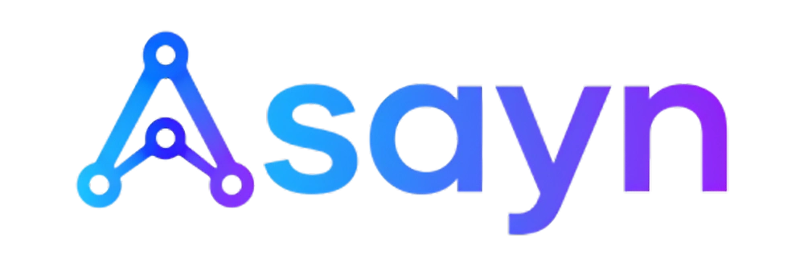

# Asayn

<p align="center">
  
</p>

[中文](README.zh-CN.md) | English

**Asayn = agent skills are all you need.**

Asayn is a Go-based terminal agent inspired by Claude Code. It provides a Bubble Tea TUI, OpenAI-compatible model access, workspace-aware sessions, configurable root/sub agents, skill packages, MCP tools, shell execution, and automatic context compaction.

## Contents

- [Install](#install)
- [Quick Start](#quick-start)
- [What Asayn Creates](#what-asayn-creates)
- [Configuration](#configuration)
- [Commands](#commands)
- [Tools and Capabilities](#tools-and-capabilities)
- [Build From Source](#build-from-source)

## Install

### Desktop GUI

Download the latest desktop package from [GitHub Releases](https://github.com/daife/Asayn/releases/latest). The GUI bundles the local Go agent engine, so a separate CLI installation is not required.

Asayn publishes two desktop variants:

- **Tauri desktop**: the default, smaller package. It uses the system WebView/WebKit runtime and is recommended for most users.
- **Electron desktop**: a fallback package named `Asayn-Electron-*`. It bundles Chromium, so downloads are larger, but it avoids missing WebView runtimes and WebView-version differences on some devices.

If the Tauri build opens to a blank screen, shows WebView-specific rendering bugs, or the target system does not have a reliable WebView runtime, use the Electron package instead.

#### Windows x64

Download and run one of these assets:

- `Asayn_*_x64-setup.exe`: recommended NSIS installer.
- `Asayn_*_x64_en-US.msi`: MSI package for managed or manual installation.
- `Asayn-Electron-*-windows-x64.exe` / `.msi`: Electron fallback installers for machines with WebView issues.

After installation, launch **Asayn** from the Start menu. Use **Open workspace** to select a project directory. On first launch, the GUI creates the same `~/.Asayn/` defaults and workspace `.Asayn/` state as the CLI. Configure your provider and API key in `~/.Asayn/api_config.toml`; the file can also be opened from the GUI agent settings. The settings panel also includes the same Claude Code skills and MCP migration flow offered by the one-command installers.

#### Linux x64

Choose either Tauri package from the latest release:

```bash
# Debian / Ubuntu
sudo apt install ./Asayn_*_amd64.deb

# Portable AppImage
chmod +x Asayn_*_amd64.AppImage
./Asayn_*_amd64.AppImage
```

Electron fallback packages are also available as `Asayn-Electron-*-linux-x86_64.AppImage` and `Asayn-Electron-*-linux-amd64.deb`. Use them when the system WebKit/WebView stack is missing or behaves inconsistently.

The desktop release currently provides Windows x64 and Linux x64 packages for both Tauri and Electron. macOS users can use the CLI release assets or build the desktop app from source.

The GUI and CLI share configuration under `~/.Asayn/`, including providers, agents, skills, MCP servers, usage data, and the workspace session index.

### Terminal CLI

#### Linux

```bash
curl -sSL https://raw.githubusercontent.com/daife/Asayn/main/install.sh | bash
```

The Linux installer downloads the latest GitHub release, installs `asayn` to `~/.local/bin`, updates your shell PATH when needed, and can optionally migrate Claude Code skills and MCP server configs.

#### Windows PowerShell

```powershell
Invoke-WebRequest -Uri "https://raw.githubusercontent.com/daife/Asayn/main/install.ps1" -OutFile install.ps1 && .\install.ps1
```

Or use the batch wrapper:

```cmd
curl -o install.bat https://raw.githubusercontent.com/daife/Asayn/main/install.bat && install.bat
```

The Windows installer installs `asayn.exe` to `%USERPROFILE%\.local\bin`, updates the user PATH, and can run the same Claude Code migration flow. Current release assets provide Windows amd64 binaries.

#### macOS

Release assets include `asayn-darwin-amd64` and `asayn-darwin-arm64`. The current `install.sh` downloads Linux assets, so on macOS use the release asset manually or build from source.

#### Claude Code Migration

The Linux and Windows installers can scan common Claude Code locations for skills and MCP server configs. Each discovered skill or MCP server is shown as a numbered item; duplicates are marked and skipped. Selected skills are copied to `~/.Asayn/skills/`, and selected MCP servers are written as individual JSON files under `~/.Asayn/mcp/`.

## Quick Start

For the GUI, start **Asayn**, click **Open workspace**, and select the project directory you want the agent to use.

For the terminal client:

```bash
cd /path/to/your/project
asayn
```

On first run, Asayn creates global defaults under `~/.Asayn/` and workspace state under `<project>/.Asayn/`. Edit `~/.Asayn/api_config.toml`, set the API key for your provider, then start chatting in the TUI.

## What Asayn Creates

Global configuration:

```text
~/.Asayn/
  api_config.toml
  root_agents/
  sub_agents/
  special_agents/
  skills/
  mcp/
  usage.jsonl
```

Workspace state:

```text
<workspace>/.Asayn/
  .sessions/
    root_agents/
    sub_agents/
    special_agents/
```

Asayn embeds the `default_Asayn/` directory into the binary. On startup, missing default files are copied into `~/.Asayn/` without overwriting existing files. The workspace `.Asayn/` directory stores sessions; if the workspace already has a `.gitignore`, Asayn appends `.Asayn/` when it is not already listed.

## Configuration

### API Providers

Edit `~/.Asayn/api_config.toml`:

```toml
[providers.DeepSeek]
url = "https://api.deepseek.com"
api_key = "your_api_key"
timeout_seconds = 120
allowed_models = [
  "deepseek-v4-pro",
  "deepseek-v4-flash"
]
```

The bundled default config includes DeepSeek, SiliconFlow, and XiaomiMIMO examples. Each provider selects `api_type = "chat_completions"` (default, compatible with existing configs) or `api_type = "responses"`. Asayn appends the matching `/chat/completions` or `/responses` endpoint and also accepts a full endpoint URL. Include `/v1` in the URL when required by your provider.

```toml
[providers.OpenAI]
url = "https://api.openai.com/v1"
api_key = "your_api_key"
api_type = "responses"
prompt_cache_key = "asayn"
timeout_seconds = 120
allowed_models = ["your-model"]
```

Set the agent's `provider` and `model` accordingly. Root, subagent, and compaction calls support both protocols. Each persisted session stores its own `cache_session_id` and `prompt_cache_key`. Agent requests use that session key (overriding the provider-wide value), and Responses requests also send a stable `session-id` header. Restoring or retrying a session reuses its identity; legacy sessions derive it from their existing UUID. New sessions, persistent forks, and independent subagents have distinct identities; temporary compaction copies inherit the original identity. Provider `prompt_cache_key` and Responses `user` fallback remain available for standalone clients without a session. Chat Completions still sends configured `user` unchanged. Subscription OAuth continues to use `https://api.openai.com/v1/responses` with `store: false` and streaming; this is separate from the Codex ChatGPT backend. Cache hits depend on provider support, cache lifetime, and matching prompt prefixes; stable routing cannot guarantee a hit or physical cache isolation.

Responses uses `store = false` with independent local histories and persists encrypted reasoning items for tool continuations and session restoration, without `previous_response_id`. With `thinking_enabled = true`, `reasoning.effort` is sent (`max` maps to `xhigh`); otherwise reasoning parameters are omitted and model defaults apply. Parameter support depends on your model and compatible provider.

### Agents

Agent configs live in:

```text
~/.Asayn/root_agents/*.toml
~/.Asayn/sub_agents/*.toml
~/.Asayn/special_agents/*.toml
<workspace>/.Asayn/root_agents/*.toml
<workspace>/.Asayn/sub_agents/*.toml
<workspace>/.Asayn/special_agents/*.toml
```

Root agents drive the main conversation. Sub-agents run delegated tasks with a basic tool set. `special_agents/compact_agent.toml` is used by `/compact` and automatic compaction.

Workspace agent configs take precedence over global configs with the same name. If `/model_config` saves a config that does not already exist in the workspace, it writes to the global config location.

Important fields include `provider`, `model`, `system_prompt`, `visible_skills`, `visible_mcp`, `max_output_lines`, `allow_parallel_shell`, `allow_interactive_shell`, `thinking_enabled`, `reasoning_effort`, and `auto_compact_threshold_percent`.

### Skills

Skills are directory packages containing `SKILL.md`:

```text
~/.Asayn/skills/<skill-name>/SKILL.md
<workspace>/.Asayn/skills/<skill-name>/SKILL.md
```

Workspace skills override global skills with the same declared name. Use `/model_config` to choose which skills are visible to each agent.

### MCP

MCP server configs are JSON files under `~/.Asayn/mcp/` or `<workspace>/.Asayn/mcp/`. Workspace MCP entries override global entries with the same server name. Enable per-agent visibility from `/model_config`.

```json
{
  "mcpServers": {
    "codegraph": {
      "type": "stdio",
      "command": "codegraph",
      "args": ["serve", "--mcp"]
    },
    "remote-docs": {
      "type": "streamable_http",
      "url": "https://example.com/mcp",
      "headers": {
        "Authorization": "Bearer ${MCP_TOKEN}"
      }
    }
  }
}
```

Supported transport names are `stdio`, `streamable_http`, and `http` as an alias for streamable HTTP.

## Commands

Type `/` in the TUI to see fuzzy command suggestions. `Tab` completes a selected command. When no command suggestions are active, up/down browse input history.

| Command | Description |
| --- | --- |
| `/help` | Show help |
| `/new [name]` | Start a new session |
| `/resume [session]` | Pick or resume a saved session |
| `/continue` | Continue interrupted work, checking uncertain tool effects before retrying |
| `/retry` | Retry the last user request |
| `/rename [name]` | Rename the current session |
| `/fork [name]` | Fork from the current point |
| `/root_agent [name]` | Pick or set the root agent |
| `/model [name]` | Alias for `/root_agent` |
| `/model_config` | Configure model, thinking, shell, skills, and MCP |
| `/compact` | Compress prior context with `compact_agent` |
| `/btw <question>` | Reserved for future side-channel questions |
| `/exit` | Exit the CLI |

During a running agent turn, Enter inserts the typed message after the current batch of tool calls finishes (or after the current model response if no tools are called). Tab queues a message for the next full turn. Pressing Esc cancels the last queued message, or interrupts the current turn if the queue is empty.

Enter submissions in the TUI wait 0.5 seconds. Repeated Enters within 0.5 seconds or further editing cancel the pending submission, protecting against terminals that paste newlines as Enter keys; review the draft and press Enter after the paste settles.

On Windows, `/model_config` and the GUI Agent settings include a **Git Bash** shell option for root agents. It is strongly recommended to enable Git Bash — models are generally far more proficient with bash shell commands than PowerShell. When enabled, Asayn checks that Git Bash is installed at the default path `C:\Program Files\Git\bin\bash.exe`; if it is not found, the setting is rejected and the UI asks you to install Git for Windows from <https://git-scm.com/download/win> using the default installation settings. Once enabled, shell tools are described to the model as Git Bash commands and run through Git Bash instead of PowerShell.

## Tools and Capabilities

Built-in agent tools include:

- Workspace file reading, directory listing, and regex search.
- `view_image`: workspace PNG, JPEG, GIF and WebP images, up to 20 MiB each, with optional `detail`.
- Visible skill reading.
- Synchronous shell commands.
- Optional asynchronous and interactive shell commands when enabled in agent config.
- Sub-agent listing, async start/check/resume, and delay.
- Visible MCP tools discovered from enabled MCP servers.

Sub-agents use a basic executor: file/search/skill/synchronous shell plus visible MCP, without root-agent sub-agent orchestration.

Ask the agent to inspect a workspace image, for example `screenshots/page.png`. It can call `view_image({"path":"screenshots/page.png","detail":"auto"})`; detail accepts `auto` (default), `low`, `high`, or `original`, subject to model support. File content determines the format, and paths and symlinks must stay inside the workspace. CLI, desktop, and sub-agents share the tool.

A vision-capable model is required; see [DeepSeek vision](https://api-docs.deepseek.com/zh-cn/guides/vision/). Chat Completions sends `image_url` blocks; Responses sends [`input_image`](https://developers.openai.com/api/docs/guides/images-vision?api-mode=responses). [ChatGPT subscription mode](https://developers.openai.com/siwc/token-sharing-open-source/models-and-inference) keeps the existing OAuth authentication and Responses endpoint with `store=false`, `stream=true`, and requires no additional API key. It uses the same image format, subject to account and model capabilities.

Image data persists with tool results in local sessions, allowing history restoration without rereading the source file. The UI displays file information only. Real-time context control hides stale images together with their tool results. Images increase local session size and model context usage.

## Build From Source

### Desktop app (Tauri 2 and Electron)

The optional desktop client lives in `desktop/`. It uses React and TypeScript for the interface while retaining the Go agent engine as a bundled sidecar, so CLI and desktop sessions, tools, skills, MCP servers, and provider configuration use the same implementation.

The same React UI is shared by the Tauri and Electron runtimes.

```bash
cd desktop
npm install
npm run tauri dev
```

Build the Tauri desktop packages:

```bash
cd desktop
npm run tauri build
```

Build the Electron fallback packages:

```bash
cd desktop
npm run build:electron -- --win nsis msi --x64
npm run build:electron -- --linux AppImage deb --x64
```

See `desktop/README.md` for platform prerequisites and release builds.

### Terminal app

Requirements:

- Go 1.24 or newer.
- A terminal supported by Bubble Tea.
- Linux, macOS, or Windows. Other platforms require `ASAYN_ALLOW_NON_LINUX=1`.

Build:

```bash
go build -o asayn ./cmd/asayn
```

Smaller release-style binary:

```bash
CGO_ENABLED=0 go build -trimpath -ldflags="-s -w -buildid=" -o asayn ./cmd/asayn
```

Cross-compile examples:

```bash
CGO_ENABLED=0 GOOS=linux GOARCH=amd64 go build -trimpath -ldflags="-s -w -buildid=" -o asayn-linux-amd64 ./cmd/asayn
CGO_ENABLED=0 GOOS=darwin GOARCH=arm64 go build -trimpath -ldflags="-s -w -buildid=" -o asayn-darwin-arm64 ./cmd/asayn
CGO_ENABLED=0 GOOS=windows GOARCH=amd64 go build -trimpath -ldflags="-s -w -buildid=" -o asayn-windows-amd64.exe ./cmd/asayn
```

Run tests:

```bash
go test ./...
```

### ChatGPT subscription Responses

Use `subscription_responses` to authorize eligible ChatGPT plan usage through the official Sign in with ChatGPT flow:

```sh
asayn subscription login personal
asayn subscription models personal
```

Add a provider to `~/.Asayn/api_config.toml`, replacing the model slug with one returned for your account:

```toml
[providers.ChatGPT]
api_type = "subscription_responses"
subscription_account = "personal"
timeout_seconds = 120
allowed_models = ["model-slug-from-the-models-command"]
```

Select this provider and model in root, subagent, or compaction profiles. Desktop uses the same local configuration and credentials; sign in using the CLI first. Account labels default to `default`; use separate labels for different accounts/workspaces. Reauthorization reuses the registration and verifies the account identity. Refresh the model list and configuration after switching accounts.

Do not set `api_key`. This mode uses OAuth and the public `https://api.openai.com/v1/responses` endpoint. It always streams with `store=false`, converts system messages to developer messages, sends full local history, and waits for `response.completed`, including for nonstreaming internal callers. Unsupported fields and `previous_response_id` are omitted. Subscription errors never fall back to API billing.

Credentials are stored separately in `~/.Asayn/subscription/<label>.json` with private file permissions (0600, directory 0700). Keep this directory out of source control. Windows users should restrict the directory's ACL to their own account. Expiring tokens refresh automatically under a cross-process lock, with rotating refresh tokens saved atomically. Temporary failures preserve credentials; terminal refresh failures require sign-in again.

Run `asayn subscription logout personal` to revoke the renewable session and clear local tokens while retaining the registration. If remote revocation cannot be confirmed, disconnect the app in ChatGPT Settings. Login requires the browser and CLI on the same host; consult the official self-hosted VM instructions for remote installations.

Availability depends on account/workspace eligibility, regions, granted permissions, and preview restrictions. Plus usage shares a five-hour allowance across apps using the plan. Review usage and authorization in ChatGPT Settings → Usage. See the official [sign-in](https://developers.openai.com/siwc/token-sharing-open-source/sign-in), [sessions](https://developers.openai.com/siwc/token-sharing-open-source/profiles-and-sessions), [inference](https://developers.openai.com/siwc/token-sharing-open-source/models-and-inference), and [limitations](https://developers.openai.com/siwc/token-sharing-open-source/preview-limitations) documentation.
